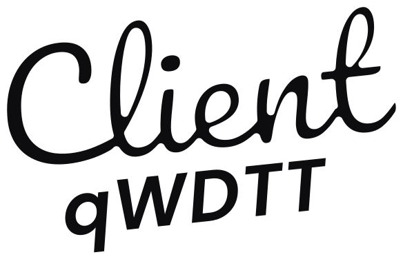
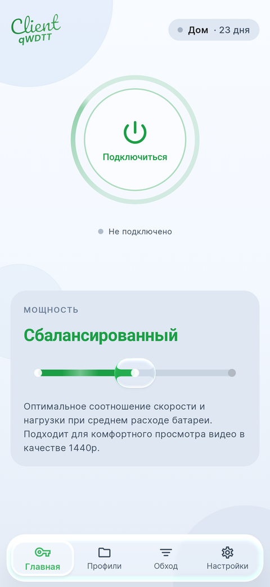
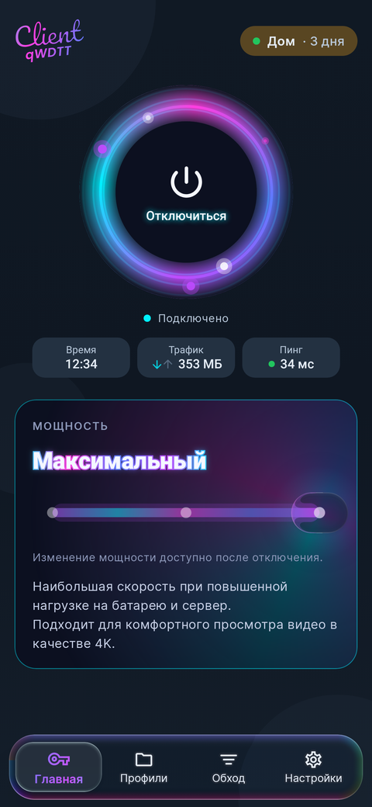
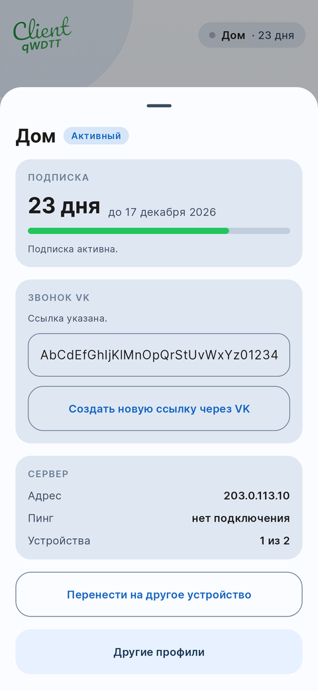
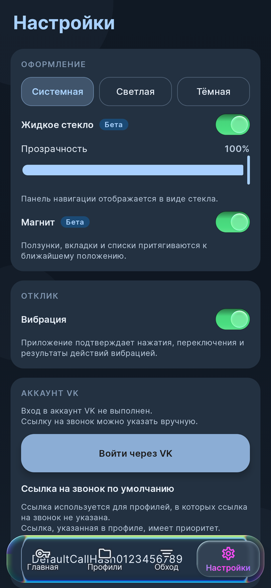

<p>
  <picture>
    <source media="(prefers-color-scheme: dark)" srcset="docs/brand/qwdtt-client-logo-dark.svg">
    
  </picture>
</p>

# qWDTT Client

Android-клиент для подключения к серверу [qWDTT](https://github.com/SpaceNeuroX/proxy-turn-vk-android) через TURN-инфраструктуру звонков VK.

Приложение создаёт системный VPN-туннель, передаёт трафик через VK TURN и выпускает его в интернет через сервер qWDTT. qWDTT Client — облегчённая версия: в нём только подключение в режиме RAW, без установки и администрирования серверов. Профиль подключения выдаёт владелец сервера.

<p>
  
  
  
  
</p>

## Возможности

- Подключение одной кнопкой; время, трафик и пинг до сервера на главном экране.
- Три уровня мощности: «Стабильный», «Сбалансированный», «Максимальный».
- Сведения о подписке с сервера: срок действия и число привязанных устройств; предупреждение об окончании подписки.
- Добавление профиля по QR-коду, ссылке или файлу с предварительной проверкой сервера.
- Перенос профиля на другое устройство с отвязкой текущего.
- Выбор приложений, работающих вне туннеля или только через него.
- Виджет и кнопка в шторке быстрых настроек.
- Светлая и тёмная тема, проверка обновлений из GitHub Releases.

## Установка

1. Скачайте APK для своего устройства в разделе [Releases](https://github.com/2kristalls36-hue/qWDTT-Client/releases/latest). Для большинства телефонов подходит файл `arm64-v8a`; если архитектура неизвестна, используйте `universal`.
2. Откройте ссылку на профиль, отсканируйте QR-код или вставьте ссылку на вкладке «Профили».
3. Укажите ссылку на звонок VK в карточке профиля, если она не была передана вместе с профилем.
4. Нажмите «Подключиться» и разрешите Android создать VPN-соединение.

Последующие версии устанавливаются из приложения: «Настройки» → «Обновления».

## Сборка

Требуются JDK 17, Android SDK (platform 35, build-tools 35.0.0, NDK 27.2.12479018) и Go 1.26.

```bash
export ANDROID_HOME=/path/to/android-sdk
export ANDROID_NDK_HOME=$ANDROID_HOME/ndk/27.2.12479018
./gradlew :app:testDebugUnitTest :app:assembleDebug -PtargetAbis=arm64-v8a
```

Клиентская библиотека на Go (`go_client/`) собирается автоматически. Без ключа подписи release-сборка подписывается отладочным ключом и не устанавливается поверх опубликованных версий.

## Выпуск версии

1. Увеличьте `versionName` в `app/build.gradle.kts` и отправьте изменения в `main`.
2. Запустите workflow: Actions → Release → Run workflow, отметьте «publish». Тег `v<versionName>` создаётся автоматически.

   Альтернатива: создать тег той же версии вручную:

   ```bash
   git tag v1.0.1
   git push origin v1.0.1
   ```

3. Workflow [Release](.github/workflows/release.yml) соберёт подписанные APK для `arm64-v8a`, `armeabi-v7a`, `x86_64` и `universal`, посчитает `SHA256SUMS.txt` и опубликует GitHub Release. Приложение предложит обновление при следующей проверке.

Теги с `-alpha`, `-beta` или `-rc` публикуются как пре-релизы, приложение их не предлагает.

Ключ подписи хранится в секретах репозитория: `ANDROID_KEYSTORE_BASE64`, `ANDROID_KEYSTORE_PASSWORD`, `ANDROID_KEY_ALIAS`, `ANDROID_KEY_PASSWORD`.

## Лицензия

Проект распространяется по лицензии [GNU GPL v3](LICENSE).

## Происхождение проекта

qWDTT Client основан на исходном коде [qWDTT](https://github.com/SpaceNeuroX/proxy-turn-vk-android) (SpaceNeuroX), который, в свою очередь, развивает оригинальный проект [WDTT](https://github.com/amurcanov/proxy-turn-vk-android).

qWDTT Client не является официальной версией qWDTT или WDTT.

## Бренд

Логотип, цвета и шрифты: [docs/brand/BRANDBOOK.md](docs/brand/BRANDBOOK.md).
